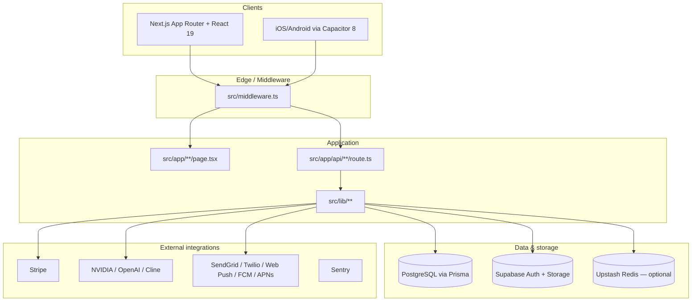

# Kynthai (kynthai-app-v2) — Phase 1 Engineering Audit

**Scope:** Discover + plan only (no application code changes in this audit).  
**Repo:** `kynthai-app-v2` (production app for [kynthai.app](https://kynthai.app)).  
**Audit date:** 2026-11-13 (Cloud Agent).  
**Base commit:** `9ca868f` on `main`.

---

## 1. Executive summary

Kynthai is a **large, feature-rich Next.js 16 monolith** (~560 TS/TSX files under `src/`, **155** App Router API route modules, **35** page routes, **42** Prisma models, **14** SQL migrations) oriented to US family health: medications/reminders, doctor consults, labs, family/caretaker portals, payments, notifications (web push / FCM / native), and multiple AI endpoints (NVIDIA NIM, OpenAI, Cline/Gemini proxy).

**Maturity:** Substantial security middleware, field-level encryption middleware, consent gates, and many Vitest tests around `src/lib/*`. Gaps include **production build blocked by TypeScript errors**, **medical file decryption API mismatch**, **incomplete erasure**, **AI routes with uneven PHI minimization**, **demo/sample data fallbacks in provider UIs**, and **no API route unit tests**.

**Legal note:** This document describes technical controls only. It does **not** assert HIPAA compliance or non-compliance.

---

## 2. Architecture



| Layer | Role | Primary paths |
|--------|------|----------------|
| **UI** | Marketing, legal, portals (patient/doctor/lab/caretaker/admin), checkout | `src/app/*`, `src/components/kynthai/*` |
| **API** | REST-style handlers, webhooks, crons | `src/app/api/**` (155 `route.ts`) |
| **Auth** | Supabase session cookies + HMAC `kynthai-session`; MFA routes | `src/lib/api-helpers.ts`, `src/lib/session-signing.ts`, `src/app/api/auth/*` |
| **Data** | Prisma ORM, encryption extension | `prisma/schema.prisma`, `src/lib/db.ts`, `src/lib/prisma-encryption-middleware.ts` |
| **Edge policy** | Rate limit (in-memory at edge), CSRF, CSP, auth prefix guard, `/api/v1/*` rewrite | `src/middleware.ts` |
| **Mobile** | Capacitor native alarms/push | `capacitor.config.ts`, `android/`, `ios/` |

**Deployment signals:** `Dockerfile.prod`, `docker-compose*.yml`, `.github/workflows/deploy.yml`, Vercel-oriented `next.config.mjs` (`output: standalone` when not `VERCEL`).

---

## 3. Technology stack

| Category | Choice | Evidence |
|----------|--------|----------|
| Framework | Next.js **16.4.6**, App Router | `package.json`, build log |
| UI | React **19.2.7**, Tailwind **4**, Radix UI, Framer Motion | `package.json` |
| Language | TypeScript **5**, `strict: true` | `tsconfig.json` |
| ORM | Prisma **6.x**, PostgreSQL | `prisma/schema.prisma` |
| Auth | Supabase SSR + custom session signing; NextAuth config present but **not mounted** | `src/lib/auth.config.ts`, no `[...nextauth]` route |
| Payments | Stripe (PaymentIntent + Checkout for labs) | `src/app/api/payments/*`, `src/app/api/stripe/webhook/route.ts` |
| AI | NVIDIA NIM, OpenAI, Cline (`src/lib/nvidia.ts`) | Env: `NVIDIA_*`, `OPENAI_API_KEY`, `CLINE_*` |
| Cache / RL | Upstash (`@upstash/redis`, `@upstash/ratelimit`) with in-memory fallback | `src/lib/rate-limit.ts` |
| Observability | Sentry (`@sentry/nextjs`) | `next.config.mjs` |
| Mobile | Capacitor 8 (iOS/Android) | `capacitor.config.ts` |
| E2E | Playwright (**18** specs) | `e2e/*.spec.ts` |
| Unit | Vitest (**32** test files under `src/`) | `src/lib/**/*.test.ts` |

---

## 4. Route inventory

### 4.1 Pages (35)

| Route | Purpose |
|-------|---------|
| `/` | Landing |
| `/login`, `/register`, `/forgot-password`, `/reset-password` | Auth |
| `/patient`, `/doctor`, `/lab`, `/caretaker`, `/family`, `/dashboard`, `/settings` | Portals / hub |
| `/admin`, `/admin-login` | Admin |
| `/checkout`, `/pricing`, `/invite`, `/download`, `/features`, `/about`, `/contact`, `/faq`, `/feedback` | Commerce & marketing |
| Legal/compliance: `/privacy`, `/terms`, `/cookies`, `/ccpa`, `/accessibility`, `/medical-disclaimer`, `/privacy-practices`, `/patient-rights`, `/grievance`, `/refund-cancellation`, `/legal` | |
| `/family/members/[id]` | Family member detail |

### 4.2 API surface (155 handlers — grouped)

- **Auth (20+):** `auth/login`, `register`, `me`, MFA, OAuth, sessions, CSRF, `demo-login` (non-prod)
- **Medications & reminders:** `medications`, `reminders/*`, `parse-schedule`, `identify-medicine`, `interactions`
- **Clinical / AI:** `chat`, `symptom-analyze`, `prescription-scan`, `prescription-intelligence`, `health-report`, `insights`, `consultation-prep`, `ai/*`
- **Doctors:** directory, dashboard, prescribe, patients/chart, templates, subscribe, availability, slots
- **Labs:** directory, dashboard, `lab-bookings`, share tokens, results upload
- **Family:** `family`, members, invite, pulse, analytics, escalation, feed
- **Payments:** `payments`, `checkout/lab-booking`, `stripe/webhook`, refunds, payouts, subscription cancel
- **Documents & upload:** `documents/*`, `upload`, health-file tokens
- **Notifications:** push, subscribe, FCM, in-app
- **User:** account, consent, data-export, notification-prefs, timezone, verify
- **Admin / system:** `admin/*`, `system/seed-demo`, `system/test-dose`, `migrate`, `bootstrap-schema`
- **Other:** emergency/SOS, video (`turn-credentials`, `video-call/token`, `webrtc-signaling`), complaints, referrals, newsletter, monitoring, audit, debug (non-prod)

**API versioning:** `/api/v1/*` rewritten to `/api/*` in middleware (`src/middleware.ts` ~490–497).

OpenAPI draft: `docs/openapi.yaml` (not verified against live handlers in this pass).

---

## 5. Data model

**42 Prisma models** including User, Medication, Reminder, Appointment, LabBooking, Prescription, Family/FamilyMember, ChatMessage, ConsultMessage, MedicalDocument, Payment, AuditLog, PushSubscription, etc.

**Encryption at rest (application layer):** AES-256-GCM via `src/lib/encryption.ts` + `installEncryptionMiddleware()` in `src/lib/db.ts`. Many PHI fields have `*_enc` columns; plaintext columns often remain for migration (`ENCRYPTION_TRANSITIONAL`). See `docs/SECURITY_REPORT.md` for coverage gaps.

**Migrations:** `prisma/migrations/*` (14 folders). Legacy SQL dumps (`schema-complete.sql`, `schema-batch*.sql`) may drift from Prisma — treat migrations as source of truth.

---

## 6. Integrations & environment variables

**Names only** (from `.env.example`, `env-template.txt` — values not recorded):

| Domain | Variables (sample) |
|--------|-------------------|
| App | `NEXT_PUBLIC_APP_URL`, `NODE_ENV`, `NEXT_PHASE` |
| Database | `DATABASE_URL`, `DIRECT_URL`, `POSTGRES_*` |
| Supabase | `NEXT_PUBLIC_SUPABASE_URL`, `NEXT_PUBLIC_SUPABASE_ANON_KEY`, `SUPABASE_SERVICE_ROLE_KEY`, `SUPABASE_JWT_SECRET`, `SUPABASE_JWT_ES256_PUBLIC_JWK` |
| Encryption / tokens | `ENCRYPTION_KEY`, `ENCRYPTION_TRANSITIONAL`, `SESSION_SIGNING_SECRET`, `CRON_SECRET`, `MIGRATION_SECRET`, `SCHEMA_BOOTSTRAP_TOKEN`, `VIDEO_TOKEN_SECRET` |
| Stripe | `STRIPE_SECRET_KEY`, `STRIPE_WEBHOOK_SECRET`, `NEXT_PUBLIC_STRIPE_PK` |
| AI | `NVIDIA_API_KEY`, `OPENAI_API_KEY`, `CLINE_API_KEY`, `ZENMUX_API_KEY`, `ANTHROPIC_API_KEY` (latter two **not wired** in `nvidia.ts`) |
| Comms | `SENDGRID_*`, `TWILIO_*`, `VAPID_*`, `FIREBASE_*`, `APNS_*` |
| Rate limit | `UPSTASH_REDIS_REST_URL`, `UPSTASH_REDIS_REST_TOKEN` |
| Admin / demo | `ADMIN_EMAILS`, `ENABLE_DEMO`, `NEXT_PUBLIC_ENABLE_DEMO`, `ALLOW_ADMIN_AS_SYSTEM` |
| Security / AV | `CORS_ORIGIN`, `KYNTHAI_CLAMSCAN`, `KYNTHAI_REQUIRE_AV`, `TURNSTILE_*` |
| Analytics | `NEXT_PUBLIC_MIXPANEL_TOKEN`, `NEXT_PUBLIC_POSTHOG_*`, `NEXT_PUBLIC_GOOGLE_ANALYTICS` |

**Secrets in repo:** No tracked `.env` with live keys observed. `.env.example` is tracked (template). `generate_production_secrets.js` writes local placeholders only.

---

## 7. CI / automation

| Workflow | Path | Purpose |
|----------|------|---------|
| CI | `.github/workflows/ci.yml` | `npm ci`, deps audit (`scripts/deps-audit-check.mjs`), SBOM, `tsc -b`, ESLint, Vitest, E2E smoke (prod canary) |
| Deploy | `.github/workflows/deploy.yml` | Deployment pipeline |
| Secret scan | `.github/workflows/secret-scan.yml` | Gitleaks |
| Android | `android-apk.yml`, `android-release.yml` | Mobile builds |
| Cron | `reminder-push-cron.yml` | Reminder push |
| DB sync | `db-schema-sync.yml` | Schema sync |

---

## 8. Feature inventory (verified status)

| Feature | Status | Notes / paths |
|---------|--------|----------------|
| AI medicine reminders | **Implemented** | `api/medications`, `api/reminders`, `parse-schedule`, UI `components/medication/*` |
| Doctor consults | **Partial** | Appointments, prescribe, PDF, video partial; **no UI** wiring found for `consult-messages` |
| Lab tests | **Implemented** | `api/lab-bookings`, lab dashboard; Stripe checkout path |
| Family health | **Implemented** | Family APIs + `caretaker-app.tsx`, COPPA-style minor consent on member create |
| Payments | **Partial** | Stripe when configured; **mock** provider in non-production (`api/payments`) |
| Auth + MFA | **Implemented** | Supabase + `kynthai-session`; MFA routes under `api/auth/mfa/*` |
| Notifications | **Implemented** | `lib/notifications.ts`, push-server, FCM, native Capacitor |
| Video calls | **Partial** | WebRTC UI + signaling; token route documents LiveKit/mock gap |
| Admin | **Implemented** | `admin-dashboard.tsx`, `api/admin/overview` |
| AI clinical chat | **Implemented w/ guardrails** | `api/chat` + `ai-guard`, `ai-output-filter`, `phi-filter` (uneven on other AI routes) |
| Data export / delete | **Partial** | Export broad; delete omits several tables/storage (see issue register) |
| iOS / Android | **Present** | Capacitor projects; CI APK workflows |

---

## 9. Test & build evidence (this environment)

**Environment:** Node `v22.23.4`, npm `10.9.9`, Linux agent VM, **no PostgreSQL** / **no** populated `.env.local`.

### 9.1 Dependency install

```text
$ npm ci --no-audit --no-fund
npm error Missing: magicast@0.3.5 from lock file
(exit 1 — package.json / package-lock.json out of sync)

$ npm install --no-audit --no-fund
added 1167 packages in 16s
(exit 0)
```

`npm ci` **failed**; `npm install` succeeded and updated lockfile locally (reverted before commit — lock drift remains a repo issue).

### 9.2 Prisma generate

```text
$ npx prisma generate
✔ Generated Prisma Client (v6.19.3)
(exit 0)
```

### 9.3 TypeScript

```text
$ npx tsc --noEmit   → exit 2
$ npx tsc -b --noEmit → exit 1
```

Errors (excerpt):

```text
src/app/api/documents/[id]/download/route.ts(88,54): error TS2554: Expected 1 arguments, but got 4.
src/app/api/feedback/route.ts(13,15): error TS2769: No overload matches this call. ('errorMap' does not exist on z.enum)
src/lib/health-files.ts(81,36): error TS2554: Expected 1 arguments, but got 4.
src/lib/storage.ts(304,37): error TS2554: Expected 1 arguments, but got 4.
```

### 9.4 ESLint

```text
$ npx eslint src e2e scripts prisma --max-warnings=0
eslint exit:0
```

### 9.5 Vitest

```text
$ ENCRYPTION_KEY=<64-hex-test-key> npx vitest --run --reporter=verbose
Test Files  1 failed | 31 passed (32)
Tests       1 failed | 191 passed (192)
FAIL encryption-file-split.test.ts > decryptFile > round-trips the split form used by medical documents
Error: Stored file is truncated or corrupt.
(vitest exit: 1)
```

### 9.6 Production build

```text
$ npm run build
(with ENCRYPTION_KEY and dummy secrets set; DATABASE_URL unset)
✓ Compiled successfully in 13.9s
Running TypeScript ...
(same TS errors as above)
Failed to type check.
(build exit: 1)
```

### 9.7 npm audit (after install)

```json
{"info":0,"low":5,"moderate":13,"high":1,"critical":0,"total":19}
```

High: `fast-uri` (authority/scheme normalization advisories). CI uses `scripts/deps-audit-check.mjs` with allowlist.

### 9.8 Dev server & route probes

```text
$ npm run dev   # script unsets DATABASE_URL
✓ Ready http://localhost:3000
```

| Request | Status | Body / behavior |
|---------|--------|-----------------|
| `GET /` | 200 | HTML |
| `GET /login` | 200 | HTML |
| `GET /patient` | 307 | → `/login` |
| `GET /api/health` | 503 | `{"status":"degraded"}` (DB check failed) |
| `GET /api/debug` | 200 | `{"status":"ok","version":"0.2.0"}` (non-prod) |
| `GET /api/doctors` | 500 | `resolveDatabaseUrl`: `url.startsWith` when `DATABASE_URL` undefined (`src/lib/db.ts:14`) |
| `GET /api/auth/me` | 200 | `{"authenticated":false}` |
| `POST /api/migrate` | 403 | CSRF missing |
| `GET /api/system/seed-demo` | 403 | System token required |

**Could not run:** Playwright E2E (needs browser + usually DB/auth), full Stripe/AI integration tests (live API keys), Supabase storage round-trips, load tests (`load-test/`), Android/iOS native builds (toolchains not exercised here).

---

## 10. Documentation drift (internal)

| Claim | Source | Contradiction in code |
|-------|--------|------------------------|
| `strict: false` | `docs/PRODUCTION-READINESS-REPORT.md` | `tsconfig.json` `strict: true` |
| No API versioning | same | `/api/v1/*` rewrite in `middleware.ts` |
| “PRODUCTION READY” | root `PRODUCTION-READINESS-REPORT.md` | Build fails TS check in this audit |
| Zenmux/Anthropic AI | `env-template.txt` | Not referenced in `src/lib/nvidia.ts` |

---

## 11. Related deliverables

- `docs/ISSUE_REGISTER.md` — prioritized defects and remediation plan  
- `docs/SECURITY_REPORT.md` — auth, PHI, AI safety, dependency posture  
- `docs/PERFORMANCE_REPORT.md` — bundle/UX/ops performance smells  
- `docs/PRODUCTION_READINESS.md` — go-live assessment and ordered fix batches  
